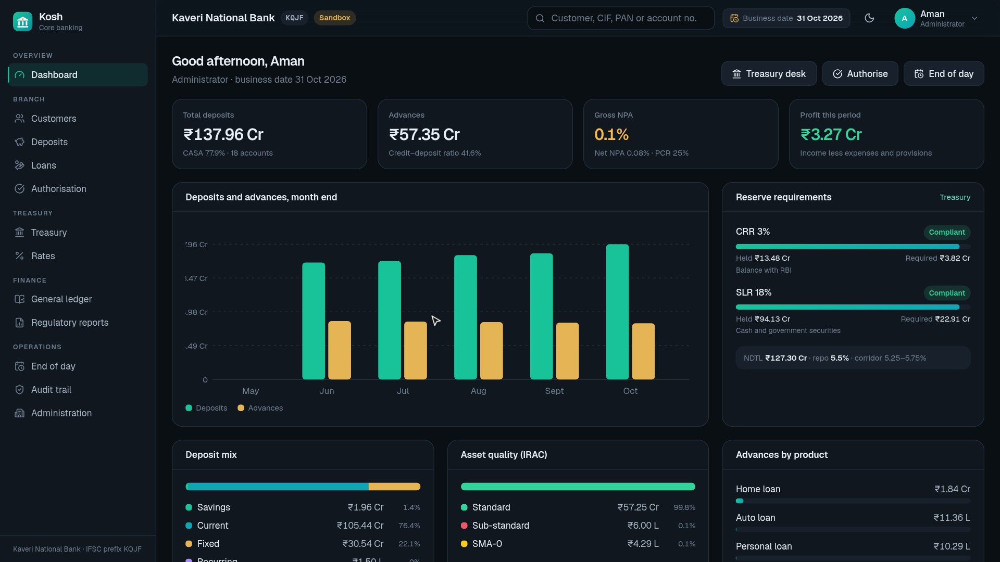
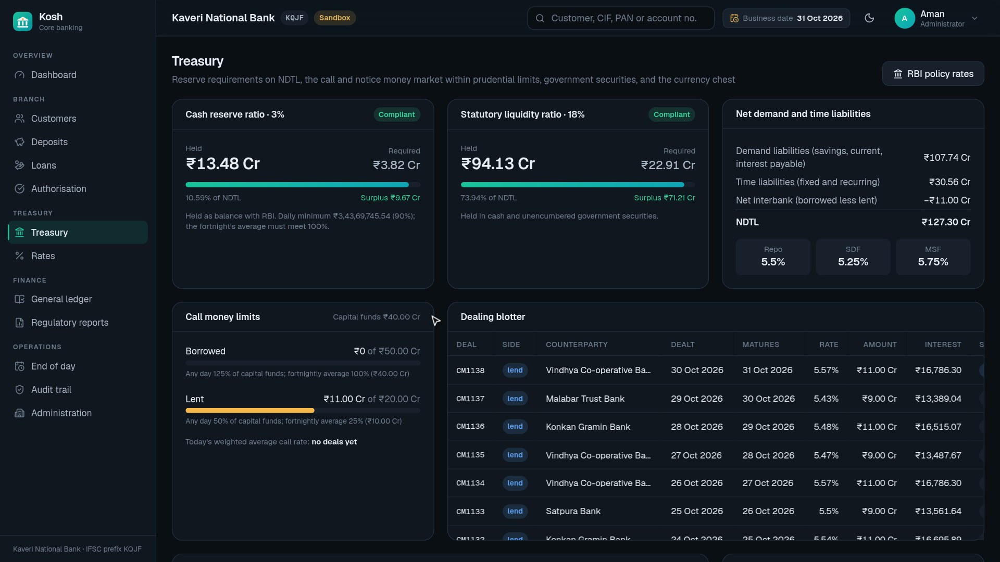
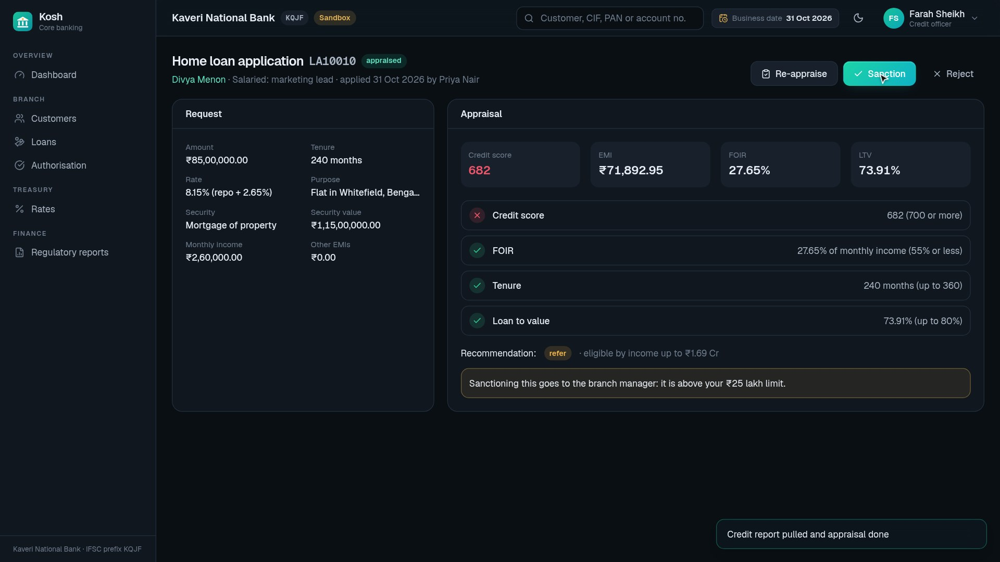
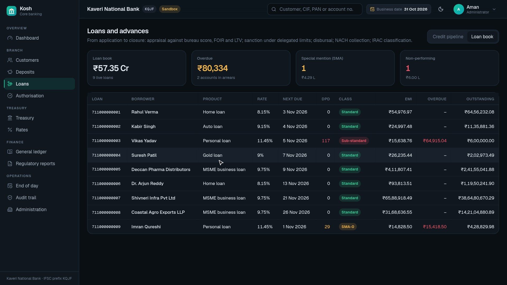
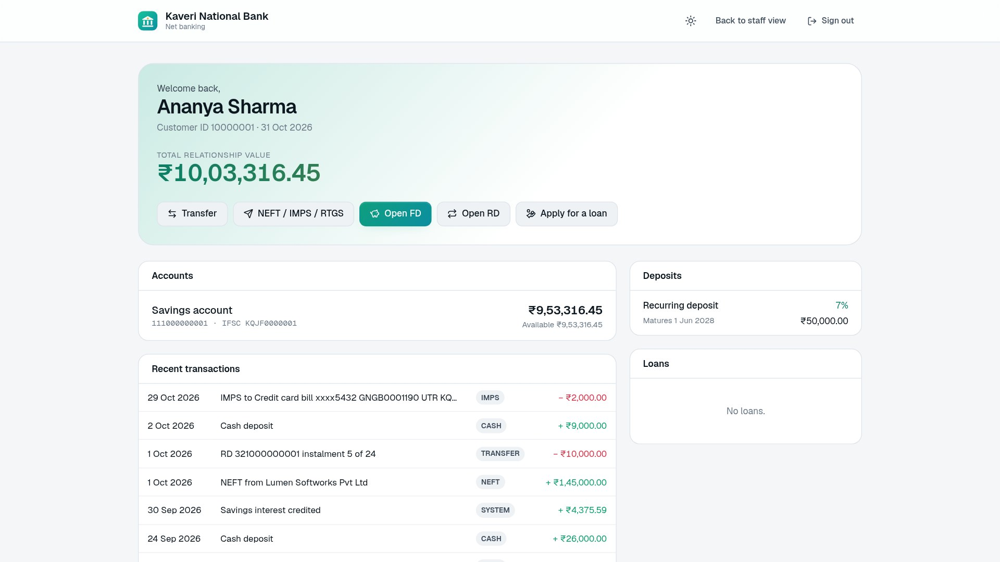
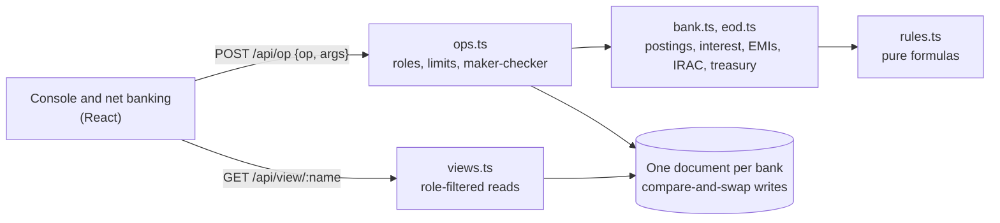

<div align="center">


# Kosh

**Open-source core banking for Indian banks: customers and KYC, savings and current accounts, fixed and recurring deposits, loans with IRAC classification, a treasury desk with CRR, SLR and call money, a double-entry general ledger, maker-checker authorisation and the end-of-day batch. One installation serves many banks.**

[](LICENSE)
[](https://nextjs.org)
[](tests)

[**Watch the demo video (4 min)**](docs/media/kosh-demo.mp4) · [Banking rules](docs/banking-rules.md) · [Architecture](docs/architecture.md)

[](docs/media/kosh-demo.mp4)

</div>

A core banking system is the ledger of record behind every branch, ATM and app: it holds the accounts,
posts every rupee, works out interest and EMIs, closes the books each night and produces what the
regulator asks for. Kosh does that in one web app. Every operation, from a cash deposit to a call money
deal, posts a balanced double-entry voucher, so the customer's statement, the loan book and the general
ledger can never disagree. The test suite replays five months of a sample bank's business and checks
that the ledger reconciles to every sub-ledger, to the paisa.

## Try it

Open a **sandbox bank**: a sample bank five months into business, with customers, salaries, deposits, a
loan book with an NPA, and a treasury desk working its reserves. You start as the administrator; the
user menu switches you to any other role, or to a customer in net banking. Every sandbox user's password
is `kosh@demo`.

```bash
npm install
npm run dev        # http://localhost:3000 → "Open a sandbox bank"
```

## Features

**Customers (CIF) and KYC**
- One customer information file per customer, shared by every account, deposit and loan.
- PAN format and uniqueness checks; Aadhaar kept as its last four digits only.
- AML risk category, occupation and income, home branch, nominees.
- Senior-citizen status worked out from the date of birth; Form 15G/15H on file.

**Savings and current accounts**
- Savings interest on the daily balance (actual/365), slabbed by balance, credited at each quarter end.
- Current accounts with overdraft limits; overdraft interest debited monthly.
- Liens, freezes, dormancy after two years without customer activity, and closure.
- Statements with every posting, channel and running balance.

**Payments at the counter and online**
- Cash deposits and withdrawals; PAN required for cash of ₹50,000 or more.
- Cash transactions of ₹10 lakh or more go into the CTR register.
- Internal transfers, and NEFT, RTGS and IMPS with IFSC validation, UTRs, RTGS and IMPS limits and
  branch charges with GST.
- Interbank payments settle through the bank's current account with the RBI.

**Fixed and recurring deposits**
- The card rate for the tenure, plus the senior-citizen extra.
- Cumulative deposits compound quarterly; payout deposits pay interest every quarter.
- Auto-renewal at maturity.
- Premature closure at the rate for the period run, less a penalty, with a quote before closing.
- Recurring deposits collected by standing instruction, with late-instalment charges.
- TDS under section 194A once a customer's interest for the year passes the threshold (catching up on
  earlier interest), 20% without PAN, waived with Form 15G/15H.

**Loans**
- Home, auto, personal, gold and MSME products; repo-linked floating rates or fixed rates.
- Appraisal pulls a credit score, then checks FOIR, loan-to-value and tenure, and recommends approve,
  refer or decline.
- Sanction under delegated limits, and disbursal net of the processing fee and GST.
- Reducing-balance EMI schedules.
- EMIs demanded and collected by NACH at end of day; returned NACH debits charged.
- Appropriation in the order charges, interest, principal; prepayment; foreclosure quotes and closure.
- A repo-rate change reprices every floating-rate loan.

**Asset classification and provisioning (IRAC)**
- Days past due set SMA-0, SMA-1 and SMA-2; past 90 days a loan becomes an NPA, and NPAs age into
  sub-standard, then doubtful (D1, D2, D3).
- On becoming an NPA, unrealised interest is reversed into interest suspense. It is recognised only when
  paid, and the loan is upgraded only when every arrear is cleared.
- Provisions follow the class: 0.4% standard, 15% or 25% sub-standard, up to 100%.

**Treasury**
- NDTL from the ledger; CRR and SLR required against held, with the 90% daily minimum.
- Call and notice money, borrowing and lending, within the prudential limits: 125% and 50% of capital
  funds on any day, 100% and 25% on a fortnightly average. Each deal shows its interest (actual/365) and
  is settled at end of day; the screen shows the day's weighted average call rate.
- RBI policy rates: repo, SDF, MSF, bank rate, CRR and SLR.
- Government securities with coupons, and cash moves between the vault and the currency chest.

**General ledger and reports**
- A chart of accounts laid out like a bank's published accounts.
- Trial balance, balance sheet, profit and loss, and a day book of every voucher.
- IRAC report, structural liquidity (ALM) buckets, the TDS register and cash transaction reports.

**Controls**
- **Roles:** administrator, branch manager, customer service officer, teller, credit officer, treasury
  dealer and auditor, plus customers in net banking. Each screen and operation is limited to the roles
  that do it.
- **Maker-checker:** cash withdrawals over ₹2 lakh, cash of ₹10 lakh or more, transfers over ₹25 lakh,
  loan sanctions over ₹25 lakh or against the appraisal, and call deals over ₹250 crore wait for a
  manager. The entry is test-posted first, and the maker can never authorise their own.
- **Audit trail:** every sign-in, posting, authorisation, rate change and batch run, which can't be
  edited.
- **End of day:** the batch that closes the books in a fixed order and moves the business date on. Run
  one day, or a quarter at once.

**Net banking**
- Customers see their accounts, deposits and loans, and recent transactions.
- They can transfer money, send NEFT, RTGS or IMPS, open FDs and RDs with a live maturity quote, pay
  overdue EMIs and apply for loans.

**Many banks**
- Each bank has its own code (which starts its IFSCs), branches, staff, customers, rates and books.

| Treasury desk | Loan appraisal |
| --- | --- |
|  |  |
| **Loan book with IRAC classes** | **Net banking** |
|  |  |

## The roles in the demo

| Person | Role | What they do |
| --- | --- | --- |
| Aman | Administrator | Opens the bank; users, branches, products, rates |
| Priya Nair | Customer service officer | Onboards customers, verifies KYC, opens accounts and FDs |
| Sanjay Kumar | Teller | Cash, transfers and remittances at the counter |
| Rohan Mehta | Branch manager | Authorises over-limit entries and sanctions; runs end of day |
| Farah Sheikh | Credit officer | Appraises, sanctions (within limit) and disburses loans |
| Vikram Iyer | Treasury dealer | Watches CRR and SLR, deals call money, enters RBI policy rates |
| Leena D'Souza | Auditor | Reads the ledger, reports and audit trail |
| Ananya Sharma | Customer | Net banking |

All the people, banks and counterparties in the sample data are fictional.

## How it works



- **One posting path.** Every movement of money goes through `book()` in [src/lib/bank.ts](src/lib/bank.ts),
  which posts a balanced voucher and writes the statement lines in the same step.
- **Pure rules.** Interest, EMIs, FD and RD maturity, TDS, IRAC classes and provisions, NDTL, and the
  CRR, SLR and call money limits are plain functions in [src/lib/rules.ts](src/lib/rules.ts), tested on
  their own. The formulas are written out in [docs/banking-rules.md](docs/banking-rules.md).
- **Atomic operations.** Each bank's books are one document. An operation reads it with its version,
  applies the change and writes it back only if nobody else wrote in between, retrying otherwise, so
  concurrent tellers can't overwrite each other and a failed operation leaves nothing behind.
- **The business date** moves only when end of day runs, as in a real core banking system.

More in [docs/architecture.md](docs/architecture.md).

## Deploy

Kosh runs on Netlify with nothing else to set up: the books live in Netlify Blobs, which supports the
conditional writes the compare-and-swap needs. Anywhere else (`npm run build && npm start`) it keeps
everything in memory, which suits a demo but not production. For a production deployment, implement the
`KV` interface in [src/lib/store.ts](src/lib/store.ts) over PostgreSQL or another durable store.

## Development

```bash
npm test           # banking rules, the engine, end of day, maker-checker, a five-month sandbox reconciliation
npm run typecheck
npm run lint
```

The demo video is recorded from the running app: `npm run build && npx next start -p 3031`, then
`node docs/video/demo.mjs` (needs Chrome, ffmpeg, and [Kokoro](https://github.com/thewh1teagle/kokoro-onnx)
for the narration; see [docs/video/tts.py](docs/video/tts.py)).

## Scope

Kosh implements the banking logic faithfully, but it is not a certified system. It simulates the
connections a live bank would have: credit bureau scores come from the PAN, and NEFT, RTGS, IMPS and
NACH settle against the RBI account without a link to the payment networks. Call money interest is
recognised when a deal settles, not accrued daily. RBI rates and thresholds change; every rate is
editable, and the defaults are noted in [docs/banking-rules.md](docs/banking-rules.md).

## License

[MIT](LICENSE)
